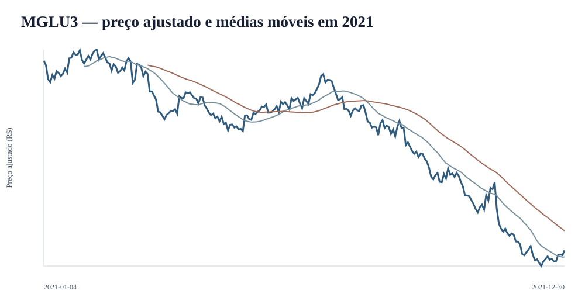
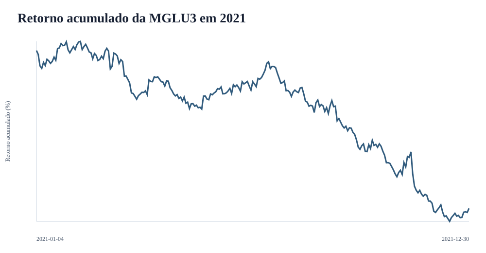
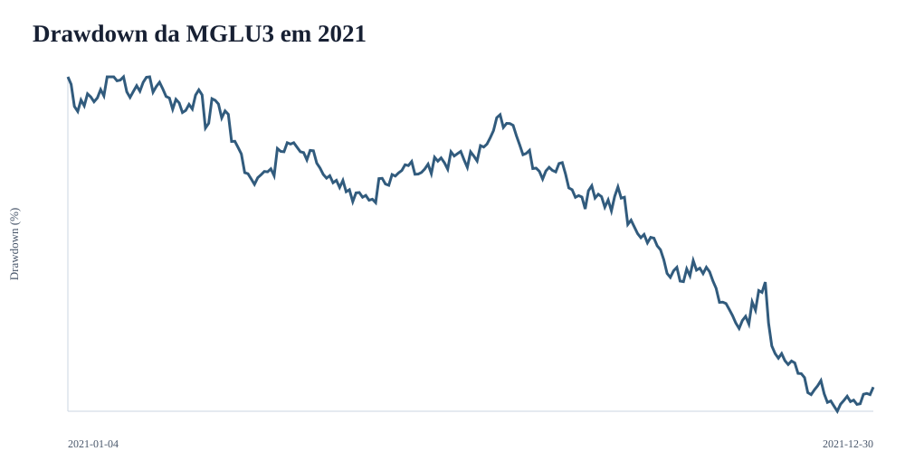
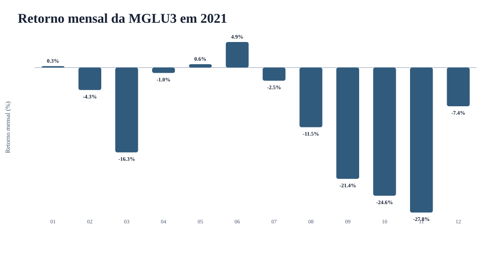
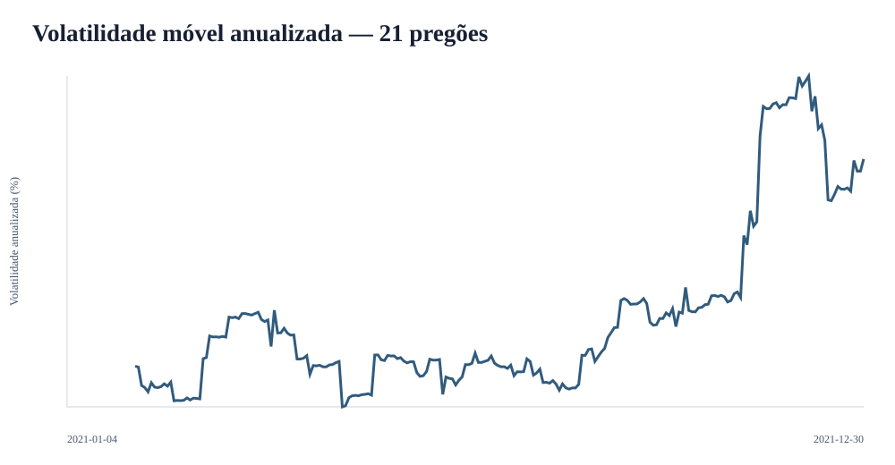
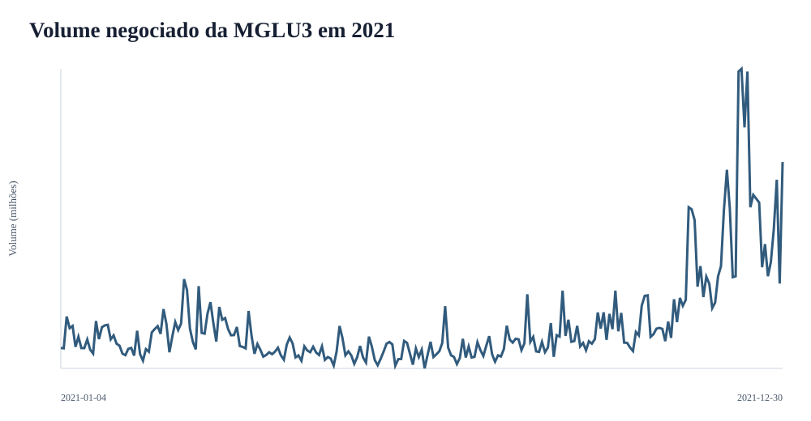
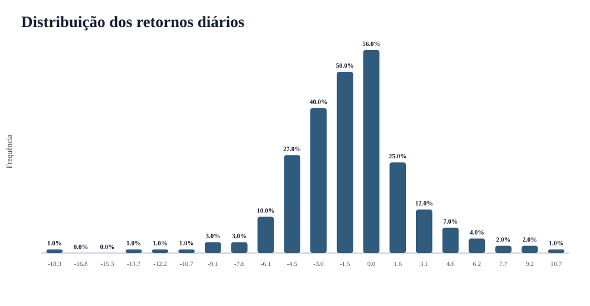

# MGLU3 em 2021 — Análise de Ações com Python

Projeto de portfólio em **Análise de Dados aplicada ao Mercado Financeiro**, usando Python para explorar risco, retorno, tendência e volume das ações do Magazine Luiza (MGLU3) ao longo de 2021.

## Pergunta central

**Como o risco, o retorno, o volume e a tendência da MGLU3 evoluíram durante 2021?**

O projeto é uma análise histórica e descritiva. **Não constitui recomendação de investimento.**

## Dataset

A base contém **247 pregões**, de **4 de janeiro de 2021 a 30 de dezembro de 2021**.

| Campo | Descrição |
|---|---|
| Date | data do pregão |
| High | maior preço do dia |
| Low | menor preço do dia |
| Open | preço de abertura |
| Close | preço de fechamento |
| Volume | volume negociado |
| Adj Close | preço de fechamento ajustado |

A série utilizada está em:

`data/raw/mglu3_2021.csv`

## Principais indicadores

- Preço ajustado inicial: **R$ 25,18**
- Preço ajustado final: **R$ 7,22**
- Retorno no período: **−71,33%**
- Drawdown máximo: **−78,11%**
- Volatilidade anualizada: **56,86%**
- Maior preço ajustado: **R$ 26,22**, em **09/02/2021**
- Menor preço ajustado: **R$ 5,74**, em **14/12/2021**
- Melhor pregão: **+12,27%**, em **05/11/2021**
- Pior pregão: **−18,32%**, em **12/11/2021**
- Volume médio diário: aproximadamente **45,4 milhões**
- Maior volume: aproximadamente **257,8 milhões**, em **09/12/2021**

## 1. Preço e tendência

O preço ajustado atingiu o maior valor da série em fevereiro e entrou em deterioração acentuada no segundo semestre.



As médias móveis de 20 e 50 pregões são utilizadas como ferramentas **descritivas de tendência**, não como sinais automáticos de negociação.

## 2. Retorno acumulado

A MGLU3 encerrou o período analisado com retorno acumulado de aproximadamente **−71,3%**.



## 3. Drawdown

O maior recuo em relação a um pico anterior chegou a aproximadamente **−78,1%**.



O drawdown complementa a análise de retorno porque mostra a profundidade das perdas observadas ao longo do caminho.

## 4. Retornos mensais

A deterioração se intensifica no segundo semestre. Setembro, outubro e novembro apresentam quedas mensais de aproximadamente **−21,4%**, **−24,6%** e **−27,8%**, respectivamente.



## 5. Volatilidade

A volatilidade anualizada calculada a partir dos retornos diários foi de aproximadamente **56,9%**.



## 6. Volume

O volume negociado aumentou em alguns dos períodos de maior estresse no final do ano.



## 7. Distribuição dos retornos diários



A distribuição evidencia que alguns pregões apresentaram variações muito superiores à média, especialmente em novembro.

## Contexto de mercado

O material original do case inclui uma notícia do **InfoMoney, de 4 de janeiro de 2022**, sobre a continuidade da queda de ações de varejistas e menciona um ambiente de juros elevados.

Esse conteúdo é tratado apenas como **contexto qualitativo posterior à série de 2021**. O projeto não afirma causalidade entre juros, notícia e retorno da MGLU3.

Mais detalhes: [reports/context.md](reports/context.md)

## Estrutura do projeto

```text
mglu3-market-analysis/
├── .github/
│   └── workflows/
│       └── python-tests.yml
├── data/
│   ├── raw/
│   │   └── mglu3_2021.csv
│   └── README.md
├── notebooks/
│   └── mglu3_market_analysis.ipynb
├── reports/
│   ├── figures/
│   │   ├── cumulative_return.svg
│   │   ├── daily_returns_distribution.svg
│   │   ├── drawdown.svg
│   │   ├── monthly_returns.svg
│   │   ├── price_moving_averages.svg
│   │   ├── rolling_volatility.svg
│   │   └── volume.svg
│   ├── context.md
│   └── summary.json
├── src/
│   ├── __init__.py
│   ├── analysis.py
│   └── metrics.py
├── tests/
│   └── test_metrics.py
├── pytest.ini
├── requirements.txt
├── LICENSE
├── .gitignore
└── README.md
```

## Como executar

Crie um ambiente virtual:

```bash
python -m venv .venv
```

No Windows:

```bash
.venv\Scripts\activate
```

No Linux/macOS:

```bash
source .venv/bin/activate
```

Instale as dependências:

```bash
pip install -r requirements.txt
```

Execute a análise:

```bash
python -m src.analysis
```

Ou abra:

```text
notebooks/mglu3_market_analysis.ipynb
```

## Testes

```bash
pytest -q
```

O repositório possui GitHub Actions para executar os testes automaticamente em pushes e pull requests.

## Tecnologias

- Python
- Pandas
- NumPy
- Matplotlib
- Jupyter Notebook
- Pytest
- GitHub Actions

## Competências demonstradas

- tratamento de séries temporais financeiras;
- cálculo de retorno simples e acumulado;
- médias móveis;
- drawdown;
- volatilidade anualizada e móvel;
- agregação mensal;
- análise de volume;
- visualização de dados;
- interpretação financeira sem extrapolar causalidade;
- organização de projeto reproduzível.

## Limitações

- a série cobre apenas MGLU3 em 2021;
- o dataset não contém benchmark como Ibovespa ou CDI;
- não há dados fundamentalistas ou macroeconômicos integrados à série;
- não há teste de estratégia ou previsão de preços;
- desempenho passado não garante resultados futuros.

## Autor

**Pablo Sena**

GitHub: [@pablosena28](https://github.com/pablosena28)
